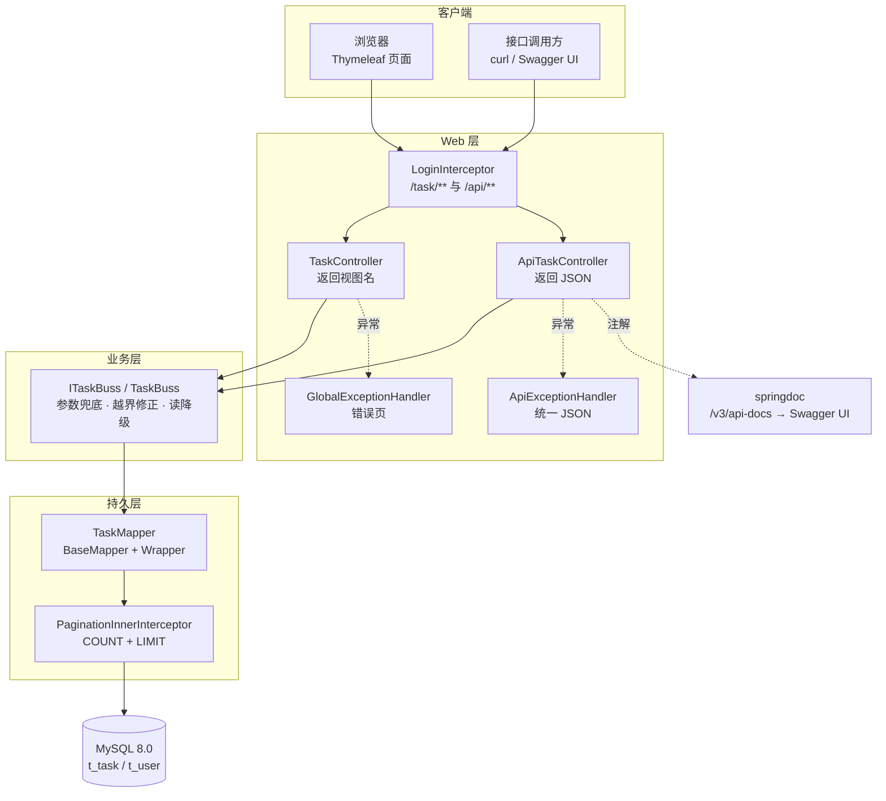

# 极简任务系统 · task-servlet-demo

<p>
  
  
  
  
  
  
  <a href="https://github.com/1522413327-cmyk/task-servlet-demo/actions/workflows/ci.yml">
    
  </a>
  
</p>

一个用于课程实践的任务管理系统：**把 SSM + JSP 的老项目改造成 Spring Boot 工程，并补齐 CI、文档、接口与测试**。
业务本身很简单（任务的增删改查 + 分页 + 登录），重点在**工程化交付**：一行 `git push` 之后自动编译、跑测试、出覆盖率、打包可执行 Jar。

- 页面入口：`http://localhost:8088/login`（演示账号 `admin / 123456`）
- 接口文档：`http://localhost:8088/swagger-ui/index.html`
- 接口手册：[`docs/API.md`](docs/API.md)
- 验收证据：[`docs/evidence/`](docs/evidence/)

---

## 目录

- [1. 功能特性](#1-功能特性)
- [2. 技术栈](#2-技术栈)
- [3. 系统架构](#3-系统架构)
- [4. 目录结构](#4-目录结构)
- [5. 环境要求](#5-环境要求)
- [6. 快速开始](#6-快速开始)
- [7. 多环境配置](#7-多环境配置)
- [8. 接口文档](#8-接口文档)
- [9. 测试与覆盖率](#9-测试与覆盖率)
- [10. 持续集成](#10-持续集成)
- [11. 范围声明](#11-范围声明)
- [12. 常见问题](#12-常见问题)
- [13. 许可证](#13-许可证)

---

## 1. 功能特性

| 能力 | 说明 |
|---|---|
| 登录鉴权 | 账号密码（MD5 摘要存储）→ Session 标记；页面未登录跳登录页，接口未登录返回 401 JSON |
| 任务列表 | 标题模糊查询 + 状态过滤 + 物理分页，支持页码越界自动回退 |
| 任务维护 | 新增 / 全量更新 / 状态流转（PATCH）/ 删除 |
| 服务端校验 | `@Valid` + `jakarta.validation`，浏览器禁用 JS 也绕不过 |
| 统一异常 | 页面请求回错误页，接口请求回统一 JSON，数据库故障单独识别为 503 |
| 双形态接口 | Thymeleaf 页面（`/task`）+ REST 接口（`/api/v1/tasks`），共用同一套业务层 |
| 多环境 | dev / test / prod 三套配置，端口、数据源、分页参数、日志级别全部外部化 |
| 可观测 | 关键失败路径带结构化日志；JaCoCo 覆盖率报告随 CI 归档 |
| 接口文档 | springdoc 扫描代码注解生成 OpenAPI 3 描述 + Swagger UI 交互界面 |

## 2. 技术栈

| 分层 | 选型 | 版本 | 为什么选它 |
|---|---|---|---|
| 语言 / 运行时 | Java | 21 (LTS) | 虚拟线程、record、模式匹配；Spring Boot 3.x 的最低要求是 17，选 21 是为了跟上主流 LTS |
| 框架 | Spring Boot | 3.4.2 | 内嵌 Tomcat，`java -jar` 即可运行，不再需要外部容器 |
| 视图 | Thymeleaf | 随 Boot | 服务端渲染，模板即 HTML，可直接用浏览器打开预览（JSP 做不到） |
| 持久层 | MyBatis-Plus | 3.5.18 | 通用 CRUD + 条件构造器 + 分页插件，省掉大量 XML |
| 连接池 | Druid | 1.2.23 | 监控完善，Boot 3 需用 `druid-spring-boot-3-starter` |
| 数据库 | MySQL | 8.0 | 课程环境统一 |
| 校验 | Hibernate Validator | 随 Boot | JSR-380 实现，注解式声明约束 |
| 工具库 | Hutool | 5.8.47 | MD5 摘要等小工具，避免自己写 |
| 接口文档 | springdoc-openapi | 2.8.9 | 运行时生成 OpenAPI 3，兼容 Boot 3.4；选型对比见 [docs/API.md](docs/API.md#1-工具选型为什么是-springdoc-而不是-knife4j) |
| 测试 | JUnit 5 + Mockito + AssertJ | 随 Boot | 纯单元测试，不启动容器、不连数据库，CI 无需 MySQL |
| 覆盖率 | JaCoCo | 0.8.11 | `mvn test` 即产出 HTML 报告 |
| CI | GitHub Actions | — | 与仓库同源，PR 上直接看绿勾 |

> 完整依赖清单见 [`pom.xml`](pom.xml)；每个依赖为什么引入、踩过什么坑，都写在 pom 注释里。

## 3. 系统架构



**一次请求的完整链路**（以 `GET /api/v1/tasks?title=报告&pageNo=2` 为例）：

1. `LoginInterceptor` 校验 Session，未登录直接 401，请求不会进入业务代码；
2. `ApiTaskController` 解析参数，`pageNo < 1` 归一为 1，`pageSize` 缺省取当前 profile 的值；
3. `TaskBuss#search` 清洗条件（空白标题视为不限）、修正越界页码，把条件交给 `LambdaQueryWrapper`、分页交给 `Page`；
4. `PaginationInnerInterceptor` 生成 `COUNT` 与 `LIMIT` 两条 SQL，MyBatis 执行；
5. 实体 `Task` 转换成 `TaskVO`（日期格式化、状态翻译成中文），包进统一响应体 `Result<PageVO<TaskVO>>`；
6. 任何一层抛异常，都由 `ApiExceptionHandler` 翻译成「HTTP 状态码 + 业务码 + 中文提示」。

**两套入口，一个业务层**：页面和接口的差异只停留在 Web 层（视图名 vs JSON），业务规则只有一份。这是为了避免"页面上能拦住、接口上拦不住"这类经典漏洞。

## 4. 目录结构

```
task-servlet-demo/
├── .github/workflows/ci.yml           # CI：质量门禁 + 构建归档
├── docs/
│   ├── API.md                         # 接口手册（设计取舍、错误码、示例）
│   └── evidence/                      # 验收证据：截图与本地执行日志
├── sql/
│   ├── init_task.sql                  # 建库 + t_task 表 + 30 条预置数据
│   └── init_user.sql                  # 建库 + t_user 表 + 演示账号
├── src/main/java/cn/edu/mju/band/
│   ├── api/                           # 对外 REST 接口（JSON）
│   │   ├── ApiTaskController.java     # 6 个接口
│   │   ├── ApiExceptionHandler.java   # 接口级异常 → 统一响应
│   │   └── dto/                       # TaskRequest / TaskStatusRequest / TaskVO / PageVO
│   ├── buss/                          # 业务接口与实现（唯一业务规则来源）
│   ├── common/                        # Result / ErrorCode / ApiException
│   ├── config/                        # 分页插件、拦截器注册、OpenAPI 元信息
│   ├── controller/                    # 页面控制器（Thymeleaf）
│   ├── entity/                        # Task / User / PageResult
│   ├── exception/                     # 页面级异常处理
│   ├── form/                          # 表单对象（String 日期 + 校验注解）
│   ├── interceptor/                   # 登录拦截器
│   ├── mapper/                        # MyBatis-Plus Mapper
│   ├── util/                          # 视图格式化工具
│   └── TaskApplication.java           # 启动类
├── src/main/resources/
│   ├── application.yml                # 公共配置
│   ├── application-dev.yml            # 开发环境（8088）
│   ├── application-test.yml           # 测试环境（8089，每页 3 条）
│   ├── application-prod.yml           # 生产环境（8080，全部走环境变量）
│   ├── mapper/                        # 历史手写 SQL（.bsk，当前不参与加载）
│   └── templates/                     # login / index / task / add_update / error
└── src/test/java/cn/edu/mju/band/     # 150 个测试，纯单元测试（无容器、无数据库）
```

## 5. 环境要求

| 组件 | 版本 | 校验命令 |
|---|---|---|
| JDK | 21 及以上 | `java -version` |
| Maven | 3.9 及以上 | `mvn -v` |
| MySQL | 8.0 及以上 | `mysql --version` |
| 浏览器 | Chrome / Edge 最新版 | — |

不需要额外安装 Tomcat：Spring Boot 已内嵌。

## 6. 快速开始

### 6.1 克隆仓库

```bash
git clone https://gitee.com/asl003/task-servlet-demo.git
cd task-servlet-demo
```

### 6.2 初始化数据库

两个脚本都自带 `CREATE DATABASE IF NOT EXISTS`，可重复执行：

```bash
mysql -uroot -p < sql/init_task.sql    # 建库 + t_task 表 + 30 条任务（用于演示分页）
mysql -uroot -p < sql/init_user.sql    # t_user 表 + 演示账号 admin / 123456
```

执行完可以自检：

```sql
USE taskmaster;
SELECT COUNT(*) FROM t_task;   -- 应为 30
SELECT COUNT(*) FROM t_user;   -- 应为 1
```

### 6.3 配置数据库口令（不要写进配置文件）

仓库里**没有任何真实口令**，启动前必须由环境变量注入：

```bash
# macOS / Linux / Git Bash
export DB_PASSWORD='你的数据库口令'

# Windows PowerShell
$env:DB_PASSWORD="你的数据库口令"

# Windows cmd
set DB_PASSWORD=你的数据库口令
```

> 不设置会怎样：Druid 拿不到连接，启动日志报 `Access denied for user 'root'@'localhost'`。
> 这是**故意的**——把默认口令写进 yml 再推到公开仓库，就是一次凭据泄露事故。

### 6.4 启动

```bash
# 方式一：Maven 直接跑（开发时用）
mvn spring-boot:run

# 方式二：先打包再运行（演示/部署用）
mvn clean package
java -jar target/task-servlet-demo.jar
```

启动成功会看到：

```
The following 1 profile is active: "dev"
Tomcat started on port 8088 (http) with context path ''
Started TaskApplication in 2.6 seconds
```

### 6.5 验证

| 检查项 | 地址 | 期望 |
|---|---|---|
| 首页 | http://localhost:8088/ | 显示欢迎页 |
| 登录 | http://localhost:8088/login | 用 `admin / 123456` 登录成功，跳转任务列表 |
| 任务列表 | http://localhost:8088/task | 显示 30 条数据，每页 5 条共 6 页 |
| 接口文档 | http://localhost:8088/swagger-ui/index.html | 6 个接口 + 模型定义 |
| OpenAPI JSON | http://localhost:8088/v3/api-docs | 返回 JSON 描述文件 |
| 接口鉴权 | `curl -i http://localhost:8088/api/v1/tasks` | 401 + `{"code":40101,...}` |

## 7. 多环境配置

| 项 | dev | test | prod |
|---|---|---|---|
| 端口 | 8088 | 8089 | 8080 |
| 数据源 | `taskmaster`（本地） | `taskmaster_test` | 全部由环境变量注入 |
| 每页条数 | 5 | 3 | 10 |
| 单页上限 | 100 | 20 | 50 |
| 日志 | mapper 打 SQL | warn + 业务 debug | warn |
| 模板缓存 | 关闭 | 关闭 | 开启 |

切换方式（优先级从高到低）：

```bash
# 1) 命令行参数（最高，适合临时验证）
java -jar target/task-servlet-demo.jar --spring.profiles.active=test

# 2) Maven 插件参数
mvn spring-boot:run -Dspring-boot.run.profiles=test

# 3) IDEA：Run Configuration → Active profiles

# 4) application.yml 里的 spring.profiles.active（默认 dev）
```

> 验证切换是否生效：切到 `test` 后端口变为 8089，任务列表每页从 5 条变 3 条（共 10 页）。
> 这个"肉眼可见的差异"是刻意设计的——配置文件写了不等于生效，必须有办法验证。

## 8. 接口文档

| 用途 | 地址 |
|---|---|
| Swagger UI（可交互） | `/swagger-ui/index.html` |
| OpenAPI 3 JSON | `/v3/api-docs` |
| 中文接口手册 | [`docs/API.md`](docs/API.md) |

接口一览（详见手册）：

| 方法 | 路径 | 说明 | 成功状态 ||---|---|---|---|
| GET | `/api/v1/tasks` | 分页查询（标题模糊 + 状态过滤） | 200 |
| GET | `/api/v1/tasks/{id}` | 按 ID 查询 | 200 |
| POST | `/api/v1/tasks` | 新增 | 201 + `Location` |
| PUT | `/api/v1/tasks/{id}` | 全量更新 | 200 |
| PATCH | `/api/v1/tasks/{id}/status` | 只改状态 | 200 |
| DELETE | `/api/v1/tasks/{id}` | 删除 | 200 |

> 文档页实际效果：[`docs/evidence/07-api-swagger.png`](docs/evidence/07-api-swagger.png)（接口与数据模型总览）、[`docs/evidence/08-api-params.png`](docs/evidence/08-api-params.png)（参数说明与示例值）。

统一响应体：

```json
{ "code": 0, "message": "ok", "data": {}, "timestamp": "2026-11-15 21:30:00" }
```

`code=0` 为成功；失败时 HTTP 状态码与 `code` 前三位一致（如 `40401` 对应 404）。完整错误码表见 [docs/API.md 第 3 节](docs/API.md#3-错误码表)。

## 9. 测试与覆盖率

```bash
mvn clean test
```

| 指标 | 结果 |
|---|---|
| 用例总数 | **150**（0 失败 / 0 跳过） |
| 执行耗时 | 约 44 秒 |
| 行覆盖率 | **95.2%** |
| 分支覆盖率 | **87.6%** |
| 方法覆盖率 | 96.0% |
| 报告位置 | `target/site/jacoco/index.html` |

测试策略：**全部是纯单元测试**，用 Mockito 打桩业务层、用 `MockMvcBuilders.standaloneSetup` 装载控制器，不启动 Spring 容器、不连数据库。好处有两个：CI 里不需要 MySQL 服务，跑得快（44 秒）；坏处是测不到真实 SQL，所以 SQL 相关的行为靠手工验证（见 `docs/evidence/`）。

| 测试类 | 覆盖点 |
|---|---|
| `TaskBussTest` / `UserBussTest` | 业务规则：参数兜底、越界修正、读降级、写失败 |
| `TaskControllerTest` / `LoginControllerTest` | 页面控制器：视图名、Model 内容、重定向 |
| `TaskValidationMvcTest` | 绕过浏览器直接 POST 非法数据，验证服务端校验 |
| `ApiTaskControllerTest` | 6 个接口的 JSON 契约：成功、校验失败、404、写失败、数据层异常 |
| `ApiExceptionHandlerTest` | 参数缺失、Content-Type 错误、请求体解析失败、约束违规 |
| `LoginInterceptorTest` | 放行 / 跳转 / 401 JSON / OPTIONS 预检 / contextPath |
| `GlobalExceptionHandlerTest` / `PageResultTest` / `TaskFormatterTest` 等 | 边界与工具方法 |

## 10. 持续集成

流水线定义：[`.github/workflows/ci.yml`](.github/workflows/ci.yml)，`push` 到 `master` 或提 PR 时触发，两个 Job：

```
test（质量门禁，34s）            package（构建归档，23s）
├─ checkout                      ├─ checkout
├─ setup-java 21 + maven 缓存    ├─ setup-java 21 + maven 缓存
├─ mvn -B clean test  ← 门禁     ├─ mvn -B package -DskipTests
└─ 归档 JaCoCo 报告              ├─ 校验 jar 是否存在
                                 └─ 上传 Artifact（38MB fat jar）
```

几个刻意的设计：

- **用 Job 依赖而不是 Step 顺序**：`package` 声明 `needs: test`，测试挂了打包作业根本不会启动——"测试不过就不产出构建物"由流水线结构保证，而不是靠脚本判断；
- **固定 JDK 21**：`pom.xml` 里 `java.version=21`，照抄模板写的 17 会编译失败；
- **不加 MySQL service**：测试全是单元测试，流水线零外部依赖，稳定且快；
- **产物与报告都归档**：Jar 用于交付，JaCoCo 报告用于验收，30 天后仍可下载。

运行记录截图见 [`docs/evidence/06-gh-run-detail.png`](docs/evidence/06-gh-run-detail.png)。

## 11. 范围声明

为了不让"没做"被误认为"忘了做"，明确列出当前不包含的能力：

| 未实现 | 原因 | 若要实现 |
|---|---|---|
| 用户注册 / 找回密码 | 课程演示只需一个固定账号 | 增加注册页 + 密码加密（BCrypt 替代 MD5） |
| 角色与权限分级 | 单用户场景无区分必要 | 引入 Spring Security + RBAC |
| 逻辑删除 | 任务量小，物理删除更直观 | 加 `deleted` 字段 + `@TableLogic` |
| 接口限流 / 幂等 | 内网演示无并发压力 | 网关限流或 `@Idempotent` + Redis |
| 前后端分离的 Token 认证 | 当前与页面共用 Session，够用且简单 | JWT + 无状态鉴权 |

## 12. 常见问题

**Q1：启动报 `Access denied for user 'root'@'localhost'`**
没设 `DB_PASSWORD` 环境变量，或口令错误。参见 [6.3](#63-配置数据库口令不要写进配置文件)。注意 IDEA 里要在 Run Configuration 的 *Environment variables* 中设置，改系统环境变量后需要重启 IDE。

**Q2：启动报 `Port 8088 was already in use`**
上一个进程没退干净。Windows：`netstat -ano | findstr :8088` 找到 PID 后 `taskkill /PID <pid> /F`；或换 profile 启动（test 是 8089）。

**Q3：`mvn test` 提示 `Skipping JaCoCo execution due to missing execution data file`**
通常发生在项目路径含中文时，JaCoCo 写不出 exec 文件。本项目已在 `pom.xml` 里把数据文件重定向到系统临时目录（纯 ASCII 路径），并给 surefire 加了 `@{argLine}` 让 agent 能挂上。

**Q4：`/swagger-ui/index.html` 404**
检查 `springdoc-openapi-starter-webmvc-ui` 的版本是否 ≥ 2.6。2.3~2.5 依赖 Spring Framework 6.1 的 API，在 Boot 3.4 上会启动失败或文档 404。

**Q5：登录成功但调接口仍返回 401**
接口与页面共用 Session。用 curl 时要带 `-b cookie.txt`（见 [docs/API.md](docs/API.md#22-认证)）；跨域调用需要 `withCredentials`。

**Q6：中文乱码**
确认数据库、连接串（`characterEncoding=utf8`）、`server.servlet.encoding` 三处都是 UTF-8；本项目三处均已配置。

## 13. 许可证

[木兰宽松许可证，第 2 版](LICENSE)（Mulan PSL v2）。
